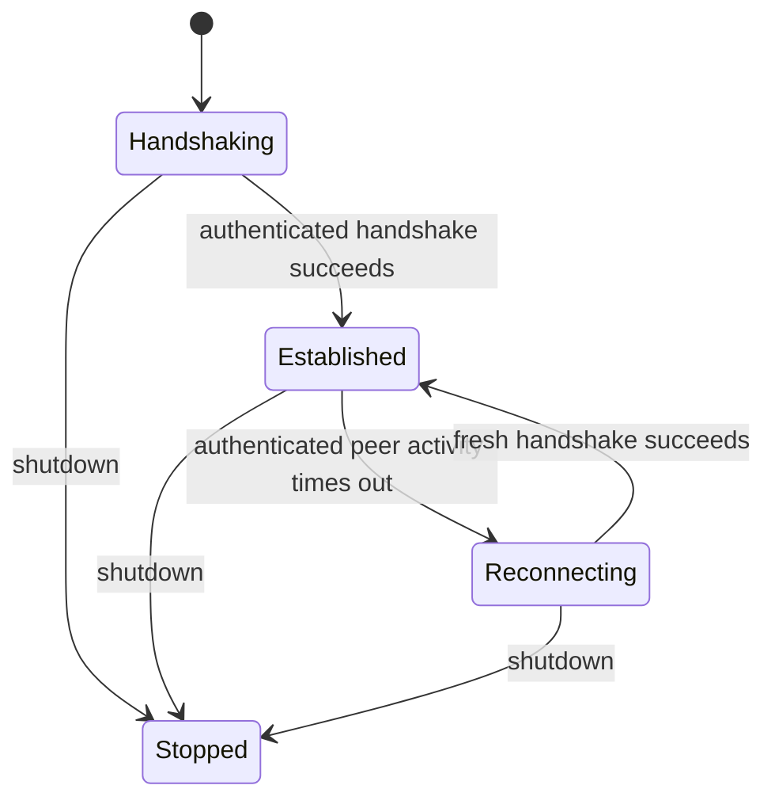

# Phase 12: tunnel lifecycle and authenticated reconnection

UDP has no connection state, so a successful handshake does not tell either peer when the other
process later exits or restarts. Phase 12 adds authenticated liveness probes, an explicit lifecycle,
and fresh-session installation without recreating the TUN interface.

## Lifecycle



The state machine rejects unsupported transitions. A timeout is an expected `PeerTimedOut` event,
not an arbitrary socket error.

## Liveness protocol

`Keepalive` and `KeepaliveResponse` are encrypted and authenticated control frames with empty
payloads. The receiver trusts them only after `CryptoReceiver::unprotect` succeeds. Any
authenticated inbound frame proves that the peer is alive and resets the missed-response count;
malformed, unauthenticated, or replayed datagrams cannot delay timeout detection.

After ten seconds without authenticated traffic, the receiver queues a keepalive. Three
consecutive unanswered probes cause the tunnel to enter `Reconnecting`.

```text
quiet interval     -> send authenticated Keepalive
peer receives it   -> send authenticated KeepaliveResponse
either control or Data received successfully -> reset liveness tracker
three missed responses -> discard old session and reconnect
```

## Concurrency and key replacement

The TUN reader, UDP receiver, and UDP sender have separate responsibilities:

```text
TUN reader ── bounded channel ──▶ sender thread ── protected UDP ──▶ peer
                                      ▲
                                      │ replaceable CryptoSender
                                      │
main supervisor ◀── timeout ── UDP receiver
```

Only the sender thread consumes cryptographic counters. Its `CryptoSender` is stored in a shared,
synchronized slot so the supervisor can remove the expired session before starting another
handshake. The lock remains held through protection and UDP send; after session removal returns,
an old encrypted frame cannot race with a new plaintext handshake datagram.

While reconnecting, the sender drains and drops queued TUN packets because no active session is
installed. This prevents unbounded memory growth and avoids delivering stale traffic after
recovery. A successful authenticated handshake installs a new sender, receiver, session ID,
directional keys, send counter, and replay window. Old cryptographic state is dropped rather than
reset or reused.

## Shutdown

Ctrl+C requests shutdown through an atomic flag. The main loop clears the active sender session,
transitions to `Stopped`, and returns normally. Process exit closes the TUN and UDP descriptors, so
Linux removes the non-persistent TUN interface. The signal handler performs no I/O or cleanup.

## Verification

Automated tests cover lifecycle transitions, missed-probe accounting, authenticated keepalive
semantics, replacement of an expired outbound session, and two consecutive authenticated
handshakes over the same connected UDP sockets. The second real-socket handshake rejects an old
protected frame and successfully carries traffic with fresh counter state.

Run the complete automated checks with:

```bash
cargo fmt --check
cargo check
cargo clippy --all-targets -- -D warnings
cargo test
```

The privileged restart test must run in an interactive terminal:

1. Start both peers with the commands in the README and verify a continuous ping.
2. Stop either `vpn_tunnel` process.
3. Observe the survivor enter `Reconnecting` after the keepalive limit.
4. Start the stopped peer again with the same command.
5. Observe both peers return to `Established` and the ping recover without restarting the survivor.

## Completion status

Phase 12 is complete in code. The tunnel has bounded outbound buffering, authenticated liveness,
peer-timeout detection, fresh authenticated reconnection, safe session replacement, and a
signal-driven `Stopped` transition. The privileged namespace restart procedure remains a manual
environment check because creating TUN devices and namespaces requires interactive sudo.
