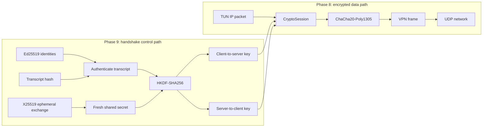
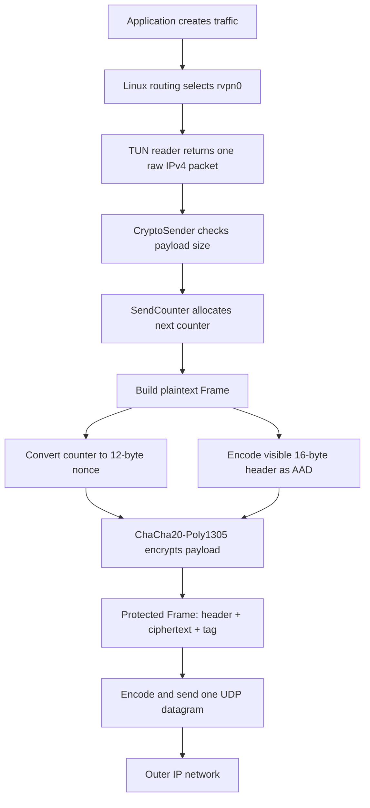
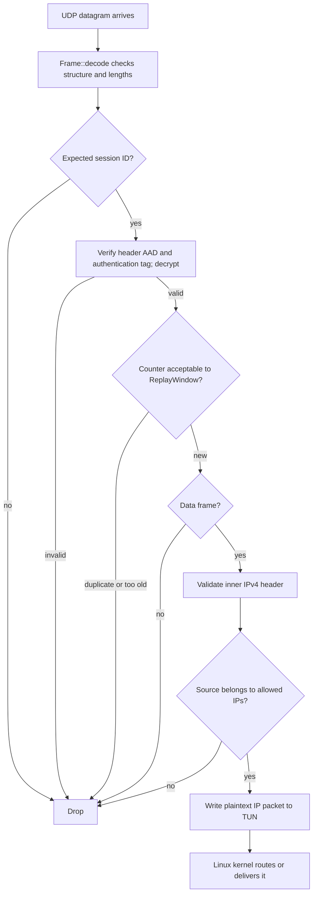
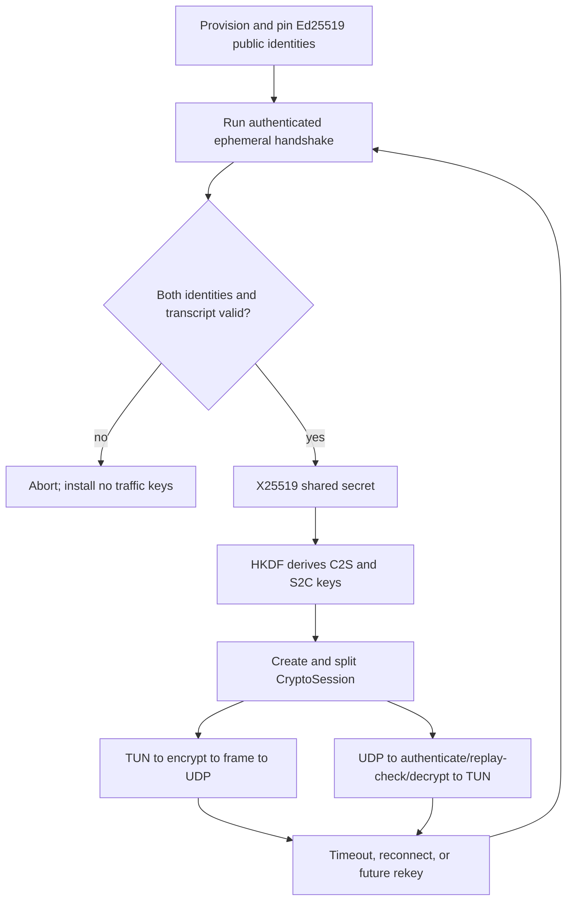

# Phases 8 and 9: cryptography, components, and data flow

This chapter explains how the cryptographic pieces fit together. Phase 8 built and tested the
encrypted packet path. Phase 9 completed a separate authenticated UDP handshake that creates fresh
session keys. Phase 10 will connect the two paths inside `vpn_tunnel`.

> This is an educational protocol, not a production-audited VPN. The handwritten modular
> arithmetic and Diffie-Hellman code exists only to teach the ideas. The tunnel uses library
> implementations for real cryptographic operations.

## The big picture

The project has two related but separate flows:

1. The **handshake path** establishes who the peer is and creates fresh session keys. Phase 9
   completed this path as a tested library module.
2. The **data path** uses those session keys to protect every IP packet. Phase 8 built this path,
   but currently supplies it with a fixed public lab secret.



The arrow from Phase 9 to Phase 8 is the key design boundary: the handshake creates keys; the
packet path consumes them. The handshake does not carry ordinary tunneled IP traffic.

## External crates and why we use them

| Crate | Version | Phase | Purpose | Used by | Important idea |
|---|---:|---:|---|---|---|
| `chacha20poly1305` | 0.11.0 | 8 | Authenticated encryption for each VPN payload | `packet_crypto.rs` | Encrypts the inner packet and detects any modification. The visible frame header is authenticated as associated data. |
| `hkdf` | 0.13.0 | 8 and 9 | Converts shared secret material into purpose-specific traffic keys | `key_derivation.rs` | A raw shared secret should not be used directly as an encryption key. |
| `sha2` | 0.11.0 | 8 and 9 | Supplies SHA-256 to HKDF and hashes the handshake transcript | `key_derivation.rs`, `handshake.rs` | Hashing creates a fixed-size digest; it does not encrypt anything. |
| `zeroize` | 1.9.1 | 8 and 9 | Overwrites secret byte arrays when explicitly cleared or dropped | `key_derivation.rs`, `identity.rs` | Reduces how long copied secret material remains in memory. It cannot erase every copy the OS or compiler may make. |
| `x25519-dalek` | 3.0.0 | 9 | Ephemeral Diffie-Hellman key agreement | `key_exchange.rs` | Both peers independently calculate the same fresh shared secret. X25519 alone does not prove identity. |
| `ed25519-dalek` | 3.0.0 | 9 | Long-term identity signatures | `identity.rs` | A signature proves that the holder of a trusted private identity key approved the transcript. It does not encrypt traffic. |
| `getrandom` | 0.4.3 | 9 | Gets cryptographically secure randomness from the operating system | `identity.rs` | Identity private keys must be unpredictable. The X25519 crate's `getrandom` feature handles its ephemeral randomness. |
| `tun` | 0.8.14 | supporting data path | Creates and reads/writes the Linux Layer-3 TUN interface | `vpn_tunnel.rs` | Gives the program raw IP packets from the kernel and accepts decrypted packets back. It is not a crypto crate. |

Rust's standard library also supplies `UdpSocket`, threads, byte vectors, errors, `Arc`, and I/O.
Those are not external crates.

### Why use crates instead of implementing real cryptography ourselves?

Cryptographic algorithms are easy to implement in a way that appears correct but leaks secrets,
reuses nonces, accepts invalid inputs, or has timing side channels. Our small `modular.rs` and
`diffie_hellman.rs` modules are useful for understanding the mathematics, but the tunnel must rely
on reviewed implementations such as the Dalek and RustCrypto crates.

## Phase 8 components

### Learning-only mathematics

| File | Responsibility | Relationship to the tunnel |
|---|---|---|
| `toy_crypto/modular.rs` | Modular multiplication, exponentiation, inverses, prime checks, and generator checks using small integers | Teaches the arithmetic behind classical Diffie-Hellman. Never used to protect tunnel packets. |
| `toy_crypto/diffie_hellman.rs` | Demonstrates public/private values, a shared secret, and the man-in-the-middle weakness of unauthenticated DH | Learning only. Never used by `vpn_tunnel`. |

The toy exchange taught the central Phase 9 lesson: two peers can create the same secret and still
have no idea whether they exchanged it with each other or with an attacker.

### Real packet-protection components

| File | Component | Purpose |
|---|---|---|
| `toy_crypto/key_derivation.rs` | `SessionKeys`, `SessionRole`, `derive_session_keys` | Runs HKDF-SHA256 and creates separate client-to-server and server-to-client 32-byte keys. The role decides which one is the send key and which is the receive key. |
| `toy_crypto/send_counter.rs` | `SendCounter` | Allocates monotonically increasing counters starting at 1 and refuses to wrap. Each counter must be used only once with one directional key. |
| `toy_crypto/replay_window.rs` | `ReplayWindow` | Remembers authenticated counters in a 64-packet sliding window. It accepts normal UDP reordering but rejects duplicates and packets that are too old. |
| `toy_crypto/packet_crypto.rs` | Frame protection functions | Creates a 12-byte nonce from the packet counter, encrypts/decrypts with ChaCha20-Poly1305, and authenticates the frame header. Authentication happens before replay state changes. |
| `toy_crypto/session.rs` | `CryptoSession`, `CryptoSender`, `CryptoReceiver` | Combines directional keys, counter ownership, AEAD, the session ID, and replay protection into one safe stateful API. |
| `protocol.rs` | `Frame` and its 16-byte header | Defines the bytes carried inside UDP: version, type, session ID, counter, payload length, and payload. |
| `bin/vpn_tunnel.rs` | Tunnel orchestration | Moves packets between TUN and UDP and applies allowed-IP checks. It currently creates the session from the intentionally insecure Phase 8 lab secret. |

### Why two directional keys?

If both peers used one key and both counters began at 1, the client and server could use the same
key/nonce pair. AEAD nonce reuse can destroy security. Directional keys make these two operations
different:

```text
client sends counter 1  -> key C2S + nonce 1
server sends counter 1  -> key S2C + nonce 1
```

The counters match, but the keys do not. A fresh handshake must still install fresh keys before
counters reset for a new session.

## Phase 8 outgoing data flow

Suppose an application sends an IP packet through a route that points to `rvpn0`:



`AAD` means **associated authenticated data**. The header remains visible because the receiver must
read fields such as the session ID and counter, but changing any authenticated header byte makes
decryption fail.

### Packet sizes

For an IPv4 outer network with a 1500-byte link MTU, the tunnel uses a 1440-byte TUN MTU:

```text
1500 link MTU
- 20 outer IPv4 header
-  8 UDP header
- 16 VPN frame header
- 16 ChaCha20-Poly1305 authentication tag
= 1440 maximum inner IP packet
```

For the 84-byte ping packet observed in the lab:

```text
84 bytes inner IPv4 packet
+16 bytes authentication tag  = 100-byte protected payload
+16 bytes VPN frame header     = 116-byte UDP payload
+ 8 bytes UDP header           = 124 bytes
+20 bytes outer IPv4 header    = 144-byte outer IP packet
```

Encryption changes the payload bytes but does not hide the outer IP/UDP headers or the VPN frame
header. An observer can still see peer addresses, ports, packet sizes, timing, session ID, and
counter.

## Phase 8 incoming data flow

Receiving must validate in a careful order:



Two ordering rules matter:

- **Authenticate before changing the replay window.** Otherwise an attacker could send a forged
  high counter and move the window forward, causing valid packets to be rejected.
- **Check allowed IPs before writing to TUN.** Otherwise an authenticated peer could inject packets
  with arbitrary source addresses.

The replay window does not make UDP reliable and it does not request retransmission. It only stops
an already accepted protected packet from being accepted again while tolerating limited reordering.

## Phase 9 components

Phase 9 must answer two separate questions:

```text
X25519: "Can both sides derive the same fresh secret?"
Ed25519: "Did the expected peer participate in this exchange?"
```

Both are required. A fresh but unauthenticated X25519 exchange is vulnerable to a
man-in-the-middle. Ed25519 signatures authenticate the exchange, while X25519 provides fresh
session secret material.

| File | Current responsibility | Status |
|---|---|---|
| `key_exchange.rs` | Generates a fresh ephemeral X25519 secret/public pair, consumes the secret to calculate the shared secret, and rejects non-contributory public keys | Implemented and unit-tested |
| `handshake.rs` | Canonically hashes the protocol domain, session ID, client ephemeral public key, and server ephemeral public key | Implemented and unit-tested |
| `identity.rs` | Generates a long-term Ed25519 identity, exposes only its public key, signs transcript bytes, and verifies signatures with a peer public key | Implemented and unit-tested |
| Handshake message encoding and state machine | Exchange messages, verify identities, derive keys, handle failure/retry, and install a `CryptoSession` | Not implemented yet |
| Identity persistence and peer configuration | Load private identity safely and pin the expected peer public key | Not implemented yet |
| `vpn_tunnel.rs` integration | Replace the fixed lab secret and fixed session ID with handshake output | Not implemented yet |

### Three different kinds of key material

| Material | Lifetime | Public or secret? | Purpose |
|---|---|---|---|
| Ed25519 identity key pair | Long-term | Private signing key; share/pin public verifying key | Stable peer identity and signatures |
| X25519 ephemeral key pair | One handshake | Private ephemeral key; transmit public key | Fresh shared secret and forward-secrecy foundation |
| ChaCha20-Poly1305 traffic keys | One session/direction | Secret | Protect ordinary VPN packets |

The Ed25519 key must not be reused as an X25519 key. Different algorithms and purposes get
different keys.

## What the transcript does

The transcript is a canonical description of the security-relevant handshake context:

```text
domain separator
|| session ID in big-endian bytes
|| client ephemeral X25519 public key
|| server ephemeral X25519 public key
```

Both peers hash those fields in exactly the same order. They sign or verify the resulting hash.

- The **domain separator** stops a signature made for another protocol or version from being
  accepted here.
- The **session ID** binds the signature to the intended session.
- Both **ephemeral public keys** bind the identities to this exact key exchange.
- The fixed **client-then-server order** binds each public key to its role. Sorting would lose that
  information.

If an attacker changes any bound field, the reconstructed hash changes and signature verification
fails.

## Completed Phase 9 handshake flow

The completed state machine exchanges four wire messages:

```mermaid
sequenceDiagram
    participant C as Client
    participant N as Untrusted network
    participant S as Server

    Note over C,S: Before connecting: each peer pins the other's Ed25519 public key
    Note over C: Generate fresh ephemeral X25519 key pair
    C->>N: ClientHello(client ephemeral public key)
    N->>S: Forward or modify packet
    Note over S: Generate fresh ephemeral X25519 key pair and choose session ID
    Note over S: Build transcript and sign its hash with server Ed25519 identity
    S->>N: ServerHello(session ID, server ephemeral key, signature)
    N->>C: Forward or modify packet
    Note over C: Rebuild transcript and verify signature using pinned server public key
    C->>N: ClientAuth(client signature)
    N->>S: Forward or modify packet
    Note over S: Verify using pinned client public key
    Note over C,S: Each side calculates the same X25519 shared secret
    Note over C,S: HKDF(shared secret + transcript context) creates C2S and S2C keys
    Note over C,S: Install CryptoSession; erase unneeded temporary secrets
    S->>N: Protected HandshakeComplete using server counter 1
    N->>C: Forward, modify, duplicate, or drop packet
    Note over C: Authenticate, decrypt, validate empty payload, and record counter 1
```

The client accepts completion only after authenticating and decrypting `HandshakeComplete`.
Plaintext, wrong-key, wrong-type, non-empty, and replayed confirmations are rejected by tests.

### Why authenticate before using the keys?

Without signature verification, an attacker can perform one X25519 exchange with the client and a
different exchange with the server. Both legitimate peers get encrypted connections, but both are
connected to the attacker. Verifying the transcript with a previously pinned Ed25519 public key
connects the fresh X25519 keys to the expected peer identity.

## Completed end-to-end design

After Phase 9 is integrated, one connection will have this lifecycle:



The essential mental model is:

```text
X25519 agrees on fresh secret material.
Ed25519 proves which peer agreed to it.
The transcript binds identity, roles, session, and ephemeral keys together.
SHA-256 gives the transcript a fixed digest.
HKDF turns shared material into independent directional traffic keys.
ChaCha20-Poly1305 encrypts and authenticates each data frame.
The counter creates a unique nonce; the replay window rejects reuse on receive.
TUN moves decrypted IP packets between the VPN process and the Linux kernel.
UDP transports the protected frames but provides no reliability or security itself.
```

## Phase 9 completion boundary

Phase 9 completed:

- explicit handshake frame and message formats;
- client and server handshake state machines;
- signature verification against pinned peer identities;
- HKDF input bound to the authenticated transcript;
- protected key confirmation;
- success and rejection tests over real loopback UDP sockets and in-memory cryptographic sessions.

The next integration phase still needs:

- secure identity-key loading/storage rather than generating a new identity every launch;
- timeouts, retransmission, duplicate-message handling, and clean failure behavior over UDP;
- installation of the negotiated session ID and keys into `vpn_tunnel`;
- executable-level integration tests for loss, reordering, reconnects, and authenticated tunnel
  traffic.

## Deferred post-quantum upgrade

Post-quantum cryptography is not required to finish the current learning VPN. We will first connect
and test the classical authenticated handshake end to end. A later crypto-agility phase can add a
hybrid design:

```text
key establishment: X25519 + ML-KEM
peer signatures:   Ed25519 + ML-DSA
packet protection: ChaCha20-Poly1305 remains
```

This is not a direct algorithm-name replacement. ML-KEM is a key-encapsulation mechanism, so its
message flow differs from X25519. ML-DSA keys and signatures are much larger than Ed25519 values,
so the current 2,048-byte frame limit cannot hold common ML-DSA signatures. The future phase must
therefore include:

- algorithm identifiers and downgrade-resistant transcript binding;
- a reviewed combiner that feeds both classical and post-quantum shared secrets into HKDF;
- versioned storage for both classical and post-quantum identity keys;
- bounded fragmentation and reassembly for large handshake messages;
- rejection tests for missing, duplicate, reordered, oversized, and modified fragments;
- compatibility tests between classical-only and post-quantum-capable peers.

The handwritten learning algorithms will not be extended into post-quantum implementations. As
with the existing X25519 and Ed25519 operations, the project must use maintained cryptographic
libraries and treat integration, validation, and protocol design as the learning work.

Standards and migration references:

- [NIST FIPS 203: ML-KEM](https://csrc.nist.gov/pubs/fips/203/final)
- [NIST FIPS 204: ML-DSA](https://csrc.nist.gov/pubs/fips/204/final)
- [NIST post-quantum migration FAQ](https://csrc.nist.gov/Projects/post-quantum-cryptography/faqs)

Even after those learning milestones, production VPN work would require protocol review, denial-of-
service defenses, privilege separation, key rotation, configuration hardening, and considerably
more testing. For real deployments, use an established, audited VPN protocol and implementation.
